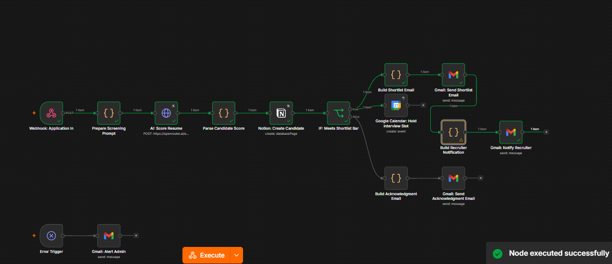

# Recruitment Resume Screening Pipeline (n8n)

An n8n automation that screens job applications the moment they come in — scoring each resume against a defined job profile with AI, logging every candidate to a single source-of-truth database, and routing strong fits into an interview workflow while keeping a human in the loop for everyone else. Built to kill the two biggest failure modes in early-stage hiring: resumes that sit unread in an inbox, and inconsistent, gut-feel screening that varies reviewer to reviewer.



## What it does

**1. Application intake → AI scoring**
- Accepts a job application via webhook (name, email, phone, role applied for, and resume text — swap in a resume-parsing step upstream if you're starting from PDFs).
- An LLM compares the resume strictly against a configurable job profile (must-have skills, nice-to-have skills, minimum experience) and returns a structured score (0–100), a matched/missing skills breakdown, and a recommendation — grounded only in what the resume actually says, with explicit instructions to flag missing information rather than invent it.

**2. Every candidate → one Notion database**
- Every applicant — shortlisted or not — gets a record in a Notion "Candidates" database: contact info, role, score, experience, matched/missing skills, AI summary, resume link, and status. This becomes the single place recruiters and hiring managers look, instead of hunting through an inbox.

**3. Score-based routing — with a human always in the loop**
- **Meets the shortlist bar** (score above threshold *and* all must-have skills present): the candidate gets an interview-invitation email with a scheduling link, a tentative interview slot is held on the calendar, and the recruiter gets a notification with the full AI breakdown.
- **Below the bar**: the candidate gets a neutral, polite acknowledgment email — never an automated rejection. Their Notion status stays "New"/"Review" for a person to make the final call. This is a deliberate design choice: the pipeline accelerates screening, it doesn't make the hiring decision.

**4. Error alerting**
- A self-referencing error workflow: if any step fails (bad credentials, API downtime, malformed resume data), an alert email fires immediately with the failed node and error message.

## Architecture

```
Webhook: Application In
   → Prepare Screening Prompt (build the AI request from job config + resume)
   → AI: Score Resume (LLM scoring against job profile)
   → Parse Candidate Score (validate + normalize AI output)
   → Notion: Create Candidate (log every applicant)
   → IF: Meets Shortlist Bar
        ├─ true  → Build Shortlist Email → Gmail: Send Shortlist Email
        │          → Google Calendar: Hold Interview Slot
        │          → Build Recruiter Notification → Gmail: Notify Recruiter
        └─ false → Build Acknowledgment Email → Gmail: Send Acknowledgment Email

Error Trigger (self) → Gmail: Alert Admin
```

## Tech stack

- **n8n** — workflow orchestration
- **OpenAI (or any OpenAI-compatible endpoint, incl. OpenRouter)** — resume scoring
- **Notion API** — candidate database (single source of truth)
- **Gmail API** — candidate and recruiter emails, plus error alerts
- **Google Calendar API** — tentative interview hold for shortlisted candidates

## Setup

1. **Notion database** — create a database named "Candidates" with these exact properties:

   | Property | Type |
   |---|---|
   | Name | Title |
   | Email | Email |
   | Phone | Text |
   | Role | Text |
   | Score | Number |
   | Experience Years | Number |
   | Recommendation | Select (`Shortlist`, `Review`) |
   | Skills Matched | Text |
   | Skills Missing | Text |
   | Summary | Text |
   | Resume Link | URL |
   | Applied Date | Date |
   | Status | Select (`New`, `Interview Scheduled`, `Hired`, `Rejected`) |

   Share the database with your Notion integration: open the database → `•••` menu → **Add connections** → select your integration.

2. **Credentials** — set up in n8n:
   - OpenAI (or OpenRouter-compatible) API credential — if using OpenRouter, set the credential's Base URL to `https://openrouter.ai/api/v1` and update the "AI: Score Resume" node's URL field to `https://openrouter.ai/api/v1/chat/completions` (generic HTTP Request nodes don't read the Base URL from the credential — the node's own URL field is what's actually called).
   - Notion API credential (integration token)
   - Gmail OAuth2 credential
   - Google Calendar OAuth2 credential

3. **Replace placeholders** in the workflow JSON before importing:
   - `REPLACE_WITH_CANDIDATES_DATABASE_ID` — your Notion database ID
   - `JOB` config object inside the "Prepare Screening Prompt" node — set your real job title, must-have/nice-to-have skills, minimum experience, and description
   - `SHORTLIST_THRESHOLD` inside the same node — score cutoff (default 75)
   - `RECRUITER_EMAIL` inside the same node — who gets notified on a shortlist
   - `admin@yourcompany.com` inside "Gmail: Alert Admin" — who gets error alerts
   - `REPLACE_WITH_SCHEDULING_LINK` inside "Build Shortlist Email" — your interview scheduling link (Calendly, etc.)

4. **Point your application source** (a careers-page form, Indeed/LinkedIn webhook, Typeform, etc.) at the webhook's production URL.

5. In workflow **Settings**, set **Error Workflow** to this same workflow, so the built-in Error Trigger branch fires on any failure.

## Sample payload (webhook)

```json
{
  "name": "Priya Sharma",
  "email": "priya@example.com",
  "phone": "+91-9876543210",
  "roleAppliedFor": "Senior n8n / Automation Engineer",
  "resumeText": "Full resume text goes here..."
}
```

## Notes

- Scoring is grounded — the LLM is instructed to base every field strictly on the resume text provided, flag missing information instead of guessing, and score conservatively when evidence is thin.
- Low-scoring candidates are never auto-rejected. The workflow sends a neutral acknowledgment and leaves the Notion status for a human reviewer — automation accelerates the funnel, it doesn't replace the hiring decision.
- Every node that reads candidate data downstream of the Notion step pulls directly from the "Parse Candidate Score" node by name (`$('Parse Candidate Score').item.json`) rather than from whatever node happens to feed it — Notion's API reshapes field names in its response, so relying on the immediate input instead of a named node reference is a common source of "undefined" bugs in multi-branch n8n workflows.
- The Google Calendar step runs with `continueOnFail`, so a calendar failure won't block the candidate or recruiter emails.
